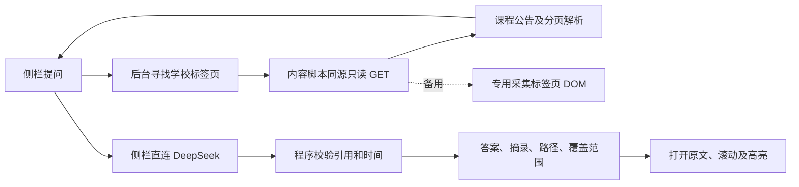

<!-- 文件用途：记录已实施的公告问答、作业截止直读架构、接口、限制和后续路线。 -->
# Blackboard 课程查询技术方案

实施日期：2026 年 10 月 8 日。个人版目标：在侧栏问 GED2005 的 Quiz 日期，按最新可见公告回答，并提供原文及回跳路径。仓库 `D:\Repo\bb`，远端 `Doris619619/AskBlackboard`，分支 `feat/20261007-bb-quiz-assistant`。

## 架构

Manifest V3、TypeScript、React、Vite，npm 锁定依赖。后台和内容脚本为独立打包脚本；没有本地 AI 代理或云端历史库。

学校登录使用正常浏览器流程，Cookie 不离开浏览器。后台协调标签页，内容脚本仅接受本扩展内部消息。读取仅限学校同源门户、公告、课程入口及内容列表 GET，拒绝作答、提交、编辑、附件和跨站地址。

## 课程与公告

解析真实 My_Courses_Tools 模块的学期、课程 ID、名称、代码及教学班。账号姓名兼容导航链接和按钮，仅读取其显示标签，不放宽通用正文对按钮、输入框和脚本的忽略规则。公告入口来自实际链接，不硬编码课程 ID。默认学期仅从含有效课程的四位 UG/PG 编号中按时间排序，排除 No Term Assigned 等文字标签和空分组；无编号时回退第一门有效课程的学期。仅当前学期只有一门课程时自动默认选择；多课程账号初始为空。`course-resolution.ts` 在采集前优先匹配问题中的完整课程号或目录中真实存在的编号前缀简称（如 GEB），只在唯一时自动切换。多课程、多班组、历史学期需要明确选择；没有课程指代时才使用顶部选择。支持 ged2005、GED 2005、GED-2005，不对 GEB/GED 做模糊纠错。

解析 announcementList，正文读取整个 .vtbegenerated，包含 MessageUniqueBody 之前的内容。所有已识别安全分页逐页读取：最多 20 页、约 60 秒，每页 15 秒。缺正文、超过上限或后续分页失败显示 partial；登录、错误或条款页不能当成空公告。

每条来源包含 sourceId、courseId、title、publishedAt、body、url、anchorId、breadcrumb、fetchedAt。整轮快照含 coverage.status、pagesRead 与警告。

每个新问题刷新选定课程全部可见公告，完整正文直接作为模型证据；不建立向量数据库和历史库。模型重试复用本轮检索时间明确的证据，会话只存侧栏内存。

## 模型与证据

固定接口 https://api.deepseek.com/chat/completions，默认 deepseek-flash，thinking.type=disabled，stream=false，response_format.type=json_object，max_tokens=1024。首轮60秒，临时超时、网络错误、429或5xx自动重试一次90秒；退避1.5秒，Retry-After最多10秒，总模型等待上限约160秒。15秒显示慢请求进度。取消会中断请求或退避，不发后续请求。鉴权、余额、格式和依据校验失败不自动重试。密钥在 chrome.storage.local 的 TRUSTED_CONTEXTS 中，内容脚本不能读取，不经 runtime 消息传递。

模型输出 {status, answer, citations}。status 为 found、not_found、conflict，引用为 {sourceId, quote}。程序验证 JSON、选定课程来源、原文连续摘录和可识别的日期、星期、钟点与时长；分别绑定测验编号与教学班，区分明确改期与冲突。无效输出报错并保留公告，模型不生成可点击链接。

相对周表达按方向和星期归一化，中英文可以对应，但不把相对周转换为日历日期；明确星期可支持仅提及该周的较粗表达，反向禁止补星期。

日期校验覆盖已测试格式，并非所有自然语言的完整逻辑证明。复杂表述仍依赖模型说明不确定；被拒绝时可直接查看来源。只读公告不代表查遍课程资料。

出处由课程公告 URL 和真实条目锚点生成，后台打开后内容脚本滚动并高亮。不读取公告中指向测验作答或作业提交的链接。

## 作业截止直读

`deadlines.ts` 识别作业、report/报告、lab/实验、project/项目、code/代码与截止/ddl/due/when意图，沿用课程消歧。`deadline-client.ts` 并行调用既有公告和作业采集接口，返回scope=deadlines的联合快照，不要求密钥或模型。单路传输失败保留成功证据并标记partial；身份、课程或协议错误阻止回答，两路均失败不能返回空列表。其他问题走公告AI路径。

`assignment-policy.ts` 只允许同课程的 courseMain、modulepage/view 和 content/listContent.jsp 及严格参数。`assignments.ts` 从课程导航和列表标题发现文件夹，最多40页、约60秒遍历预算，单次同源请求15秒；后续失败标记 partial。支持同源请求和专用渲染标签页两条路线。提交链接只用来识别作业类型，绝不加入读取队列。仅读取 `.vtbegenerated` 和 Due Date 等标签字段；附件、测验和表单值不读取。

快照新增可选 `scope: assignments`；来源新增 `kind: assignment`，sourceId带assignment前缀，URL始终为所在内容列表。回答 `mode: extracted`，直接引用带截止含义的原文，不转换相对日期或猜测时区。指定作业编号时不借其他作业日期；多项无可靠发布时间时不认定“最新”。缺字段、超过范围或失败明确说明，不能代表课程不存在作业。出处打开列表并高亮真实条目。

`deadline-task.ts` 区分任务类型及编号；完整编号直接匹配，Lab N + Report只建立相关候选，不由同编号推断代码/报告为同一任务。按行内名称或标题范围绑定截止句，后续不同任务编号清除前一任务范围。保留L01/L02班组标记，不从合班课程名称推断用户班组。`deadline-time.ts` 只格式化明确单日期和钟点，保留原话；多日期、条件、否定、相对日期回退原话，不用Date.parse猜日历和时区。

回答新增deadlines和notices字段，DeadlineAnswer组件按“班组/时间/原话/来源按钮”呈现。截止摘录与来源绑定，读取范围放入全部资料折叠区；不完整和候选提示仍可见。AI时间问题提示词要求简短回答，引用默认展开。窗口级sidePanel仍沿用现有行为，不扩大学校内容脚本注入或网络读取权限。

## 界面与恢复

侧栏每次后台请求前发送ping校验 `runtime-version.ts` 的消息协议号。旧版返回true或协议不匹配时，在学校采集前返回 `extension_reload_required`；受限操作收到invalid_message时同样提示重新加载。界面提供用户主动触发的 `chrome.runtime.reload()` 按钮，明确说明侧栏会关闭、设置保留。仅刷新学校页面不会替换旧worker；不自动重载以免丢失当前会话。升级回归模拟旧协议worker，替换为真实新构建后点击按钮，验证worker重启、受信存储保留及作业查询恢复。

顶部课程、教学班及连接状态；中间会话和展开出处；底部输入。系统字体、15px 回答正文、紫色强调、深浅主题、44px 主要操作，键盘和中文输入法，减少动画及窄侧栏。设计审查与实际截图分别记录。

视口高度不超过 600px 或宽度不超过 260px 时改为整页滚动，避免实际 200% 缩放后固定头尾挤压正文。设置关闭后在 React 卸载模态节点的下一动画帧恢复设置按钮焦点。2026-10-14 已在真正 Edge 侧栏验证；见验收记录。

鉴权、余额、限速、服务不可用、断网、超时、截断及引用无效均显示可恢复提示，避免展示提供商原始错误。学校读取失败不回答“没有 quiz”。取消后忽略迟到采集结果。

## 真实验收基线

2026 年 10 月 8 日的 GED2005 L01 属于 2610UG，可见 4 条公告。最新标题 Class Announcement: Quiz 1 and Tutorial Schedule，发表于 2026 年 10 月 7 日，原文包含：

> Quiz 1 will take place on Monday, October 12.

支持 Quiz 1 在 2026 年 10 月 12 日，时长 20 分钟，未注明开始时刻。9 月 22 日旧公告同日。此为验收基线，日期不写入运行代码，每次仍重新读取。

实际扩展、真实模型、逐条对账、出处回跳及截图以 docs/验收记录.md 为准。

## 后续与依据

PDF、课纲、日历、提醒、历史库、后台同步及多人账号另立任务。官方 Blackboard REST/OAuth 需要学校管理员开放，个人首版不依赖它。Chrome 需独立加载测试，Edge 结果不能代替。

- [Chrome Side Panel](https://developer.chrome.com/docs/extensions/reference/api/sidePanel)
- [Chrome 内容脚本网络](https://developer.chrome.com/docs/extensions/develop/concepts/network-requests)
- [Chrome 存储](https://developer.chrome.com/docs/extensions/reference/api/storage)
- [DeepSeek API](https://api-docs.deepseek.com/)
- [Apple Typography](https://developer.apple.com/design/human-interface-guidelines/typography)
